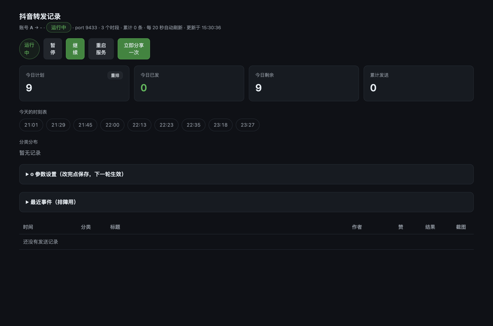

# 桌面应用（Electron）

> 状态：**P0 已完成**（开发模式可跑通）。托盘、首次向导、扫码入口、打包安装包属于 P1/P2。



## 运行方式

```bash
npm install          # 首次
npm run app:dev      # Electron 窗口加载现有控制面板
```

开发模式的隔离约定：

| 项 | 开发（`app:dev`） | 打包后 |
|---|---|---|
| 面板端口 | `9420` | `9400` |
| 数据目录 | `<repo>/data-app/` | macOS `~/Library/Application Support/抖音转发/data`<br>Windows `%APPDATA%\抖音转发\data` |
| Chrome profile 端口 | `9433` | 沿用数据库里的账号端口（默认 `9333`） |

开发库是独立的一份，不会碰到正在运行的 launchd 生产实例（`com.dsh.douyin-forwarder`，端口 9400/9333）。
可用环境变量覆盖：`DF_PORT`、`DF_DATA_DIR`。

## 进程模型

```
Electron 主进程（app/main.js）
  ├─ src/host.js：先跑一次 init（幂等），再拉起两个子进程并守护
  ├─ dashboard 子进程  → http://127.0.0.1:<port>（窗口加载的现有面板）
  └─ schedule 子进程   → 按 SQLite 排班驱动 browser-server
```

- 子进程用 Electron 自带的 Node 跑（`ELECTRON_RUN_AS_NODE=1` + `process.execPath`），
  不依赖系统 Node；Electron 45 内置 Node 24.22，`node:sqlite` 可用。
- 子进程崩溃后 2 秒自动重启；关闭窗口/退出应用会先停子进程。
- 日志：`<dataDir>/logs/{app,dashboard,schedule,init}.log`。
- 控制标记：`<dataDir>/run/{host.pid,host.json}`；面板「重启服务」写入
  `restart-scheduler` 标志，由 host 轮询后重启 schedule 子进程（不再依赖 launchd）。

## 注意：ELECTRON_RUN_AS_NODE

某些终端/IDE（包括本仓库的开发环境）会在环境里带 `ELECTRON_RUN_AS_NODE=1`。
若直接 `electron .`，Electron 会以纯 Node 身份启动并在 `require('electron')` 处崩溃。
`scripts/run-electron.js` 在启动前剥掉该变量，`npm run app:dev` 已走这个包装，无需手工处理。

## 已修的相关缺陷

- `src/dashboard.js`：截图目录默认值原来指向项目外的 `../browser-test`，与 browser-server 的
  `data/shots` 不一致；现统一为 `data/shots`。
- `src/scheduler.js`：spawn `browser-server` 增加 `windowsHide: true`，Windows 下不弹黑框。
- `src/db.js`：连接加 5 秒 busy timeout，避免面板与调度并发写时偶发 `database is locked`。
- `src/service.js`：面板状态/重启优先走 host（`data/run/host.pid`），launchd/systemd 仅作回退。

## 下一步（P1/P2）

1. 托盘菜单、关闭窗口隐藏、`app.setLoginItemSettings` 开机自启；
2. 首次运行向导（选择已有 `data` 目录 / 检测 Chrome / 扫码登录）；
3. electron-builder 打包：macOS `.dmg`、Windows NSIS（GitHub Actions `windows-latest` 出 Windows 包；
   本机装 Wine 也能打，但更推荐 CI）；
4. 旧实例接管：停 `com.dsh.douyin-forwarder`，把旧 `data/` 指向或迁移进应用数据目录。
