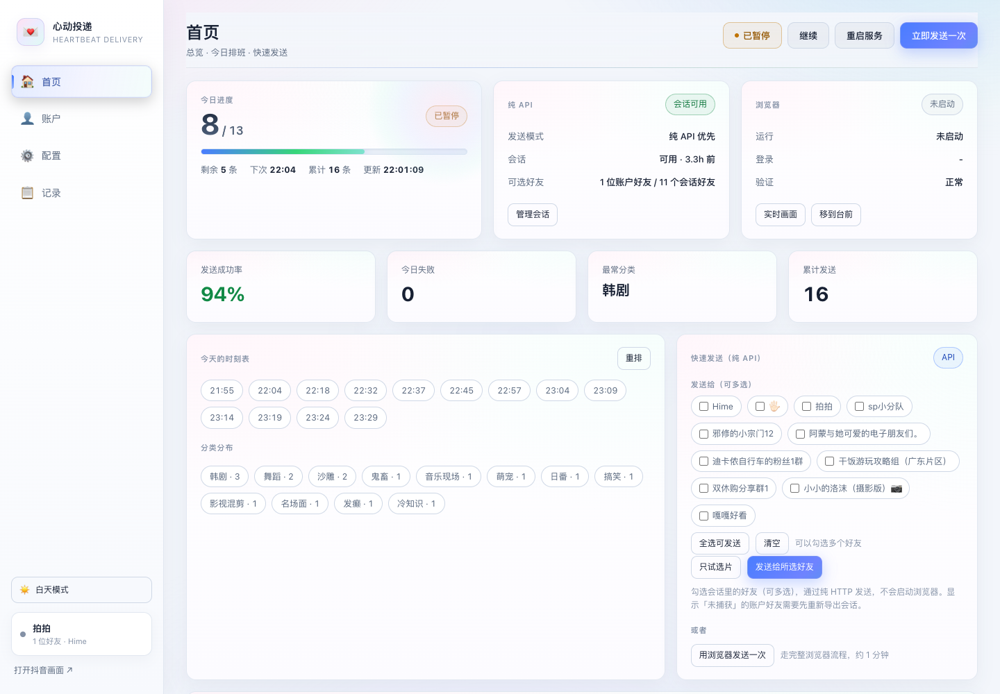
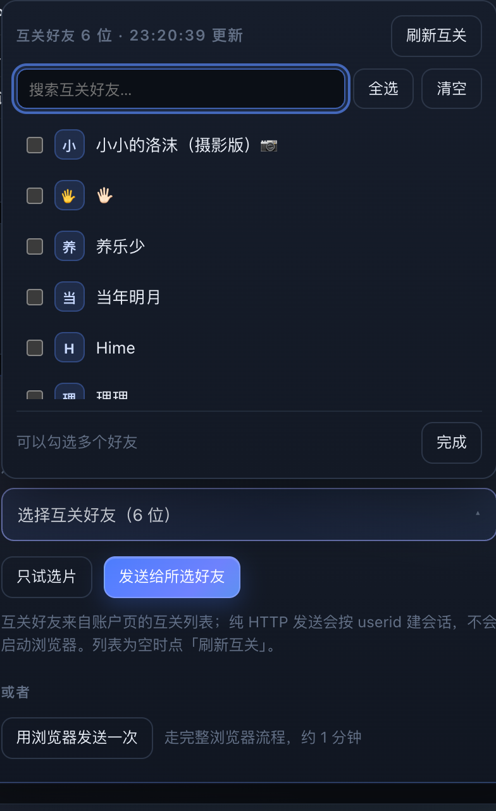
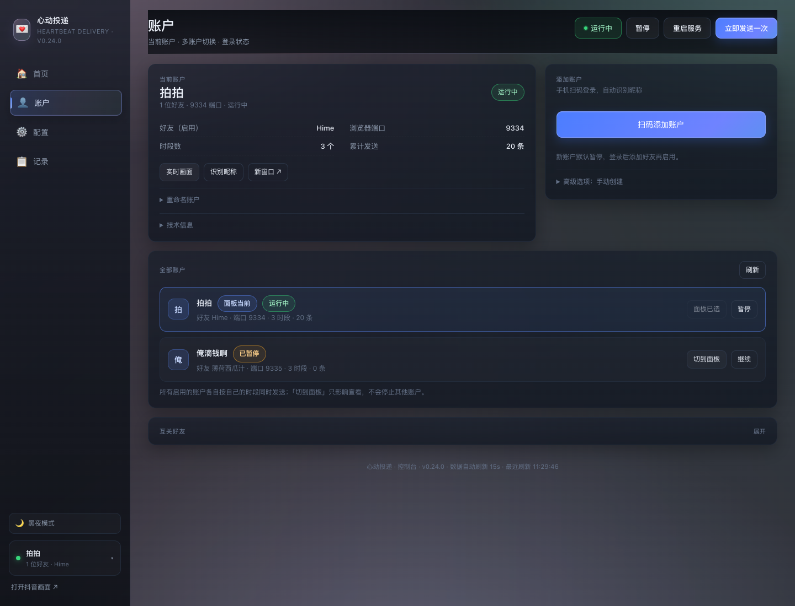
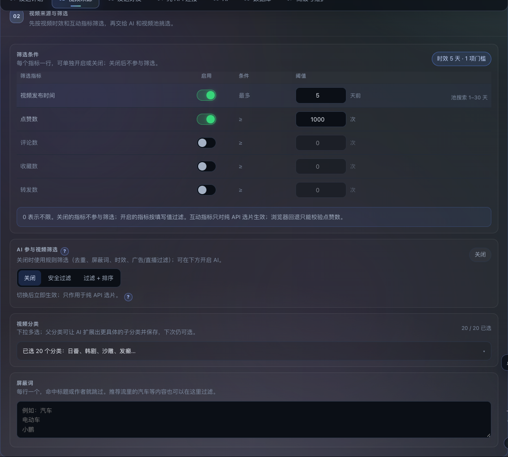
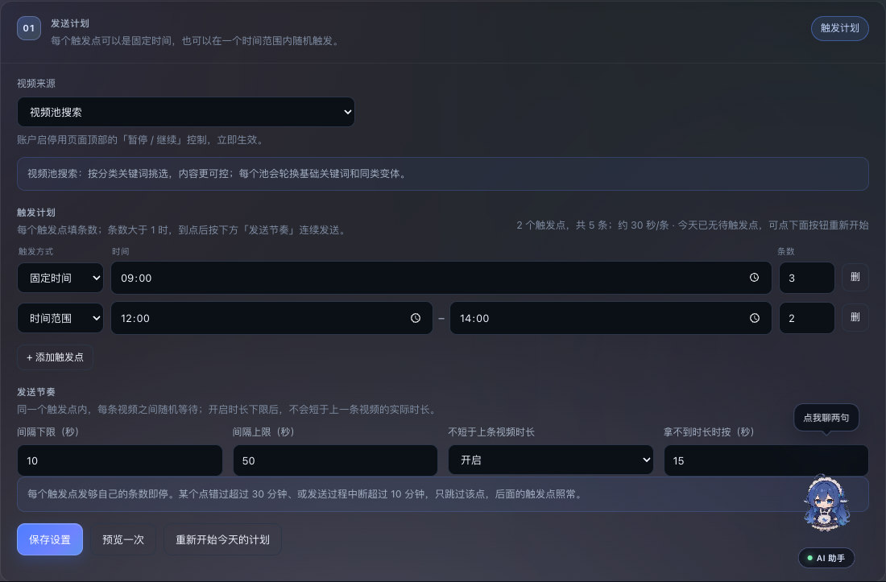
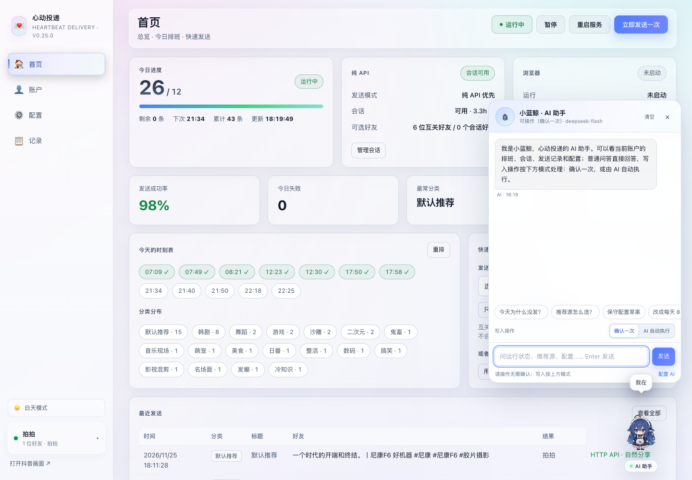

# 控制台

面板地址：`http://127.0.0.1:9400`（应用主窗口默认打开的就是它）。侧栏品牌名和页面底部显示当前版本号，
与安装包 `package.json` 的版本一致。

顶部页头在页面顶部是内容宽度内的圆角玻璃卡片；向下滚动 0-140px 时，只有背景层向主内容区
左右边缘连续伸展并收平圆角，标题和按钮位置不动；副标题淡出、标题轻微缩小。向上滚回时反向恢复。

## 白天 / 黑夜模式

侧栏底部有主题切换按钮（当前模式：🌙 黑夜 / ☀️ 白天），点击即时切换并记住选择；
首次打开跟随系统外观。



## 首页

今日进度、纯 API 会话、浏览器状态三块卡片；发送成功率/今日失败/最常分类/累计发送；
今天的时刻表、分类分布；快速发送（互关好友下拉多选 → 只试选片 / 发送）；最近发送与最近事件；
可展开「实时画面」扫码或点验证码。

### 快速发送互关好友

首页快速发送不再直接铺开会话捕获的好友/群聊，而是一个互关好友下拉多选：

- 打开时读取上次同步的互关缓存；首次使用或点「刷新互关」会重新读取（10-30 秒，会拉起一次浏览器）；
- 支持按昵称搜索、全选当前结果、清空、多选摘要和「已选 N 位」计数；
- 发送时按好友 userid 建会话，不要求对方先出现在导出会话的最近好友里；
- 互关列表按账户缓存，显示更新时间；超过 6 小时标记「已过期」，可手动刷新。




## 账户

账户页按「当前账户 + 添加账户」两栏组织：当前账户展示昵称、好友、端口、时段、累计发送，
重命名和技术信息收在折叠区；添加账户默认只有一个「扫码添加账户」主按钮，手动创建账户/端口/首好友
收在「高级选项：手动创建」里。下方是全部账户列表，所有启用的账户由各自调度子进程**同时按自己的排班发送**；
「切到面板」只影响查看的数据。浏览器登录态和纯 API 会话都按账户独立。

### 快速切换账户

侧栏左下角的账户卡片就是快速切换入口：点击展开账户浮层，列出全部账户的昵称、运行/暂停状态
和好友数，当前账户带 ✓。点击其他账户立即切换，不需要跳到账户页；切换只改变面板查看的数据，
其他账户继续按各自排班发送。键盘可用 ↑/↓/Home/End 选择、Enter 切换，Esc 或点击浮层外部关闭。


### 互关好友

账户页底部的「互关好友」是可折叠区块：展开后点「获取互关好友」会通过已登录浏览器读取关注列表，
按 `follow_status=2 / relation_label=好友` 筛出互相关注，显示昵称、关注/粉丝/互关数量。
可勾选或「全部添加」为发送好友；导入的好友带数字 userid，纯 API 发送时可直接建会话。
读取较慢（自动拉起浏览器，10-30 秒），单次最多扫描 30 页。

接口说明：网页端没有独立的「互关列表」接口，只能读取
`/aweme/v1/web/user/following/list/` 后在客户端筛选；翻页游标使用响应的 `min_time`
（不是 `max_time`）。Desktop IM 的 `/aweme/v1/web/familiar/list/` 能直接返回好友名册，
但需要桌面端 IM 签名票据，不能直接复用网页登录态。

添加账户有两种方式：

- **扫码添加账户**：账户名可留空；点击后自动创建账户、打开浏览器窗口，手机扫码登录后自动识别抖音昵称；
- 仅创建（不扫码）：手动填账户名/端口/第一个好友，之后再打开实时画面登录。

新账户默认暂停；登录成功后还会是暂停状态，添加好友后点「继续」启用。账户页也可以手动点「识别抖音昵称」。



添加账户（终端）：

```bash
node src/index.js account add D --port 9335 --friend 好友昵称
node src/index.js account switch D
```

## 配置

配置页按「header 内分区导航 + 顶部账户摘要 + 主内容」排列，所有设置仍按账户独立保存：

- **分区导航**：01–07 在页面 header 的第二行，只在配置页显示；切到其他页面时隐藏，header 恢复紧凑高度。
- **顶部摘要**：账户名、视频来源、每天总条数、好友数、推荐 feed 状态；账户启停用页面顶部的「暂停 / 继续」。
- **01 发送计划**：视频来源和统一的**触发计划**；账户启停统一用页面顶部的「暂停 / 继续」，计划卡不再重复放启用开关。每行一个触发点：
  - **触发方式**：「固定时间」按指定 HH:MM 触发；「时间范围」在起止时间之间随机取一个时刻触发。
  - **条数**：该触发点要发送的条数（1–50）。大于 1 时，到点后按「发送节奏」连续发送。
  - 每个触发点最多 12 个；固定时间或时间范围重复时保存会提示。
  - **发送节奏**（全局共用）：间隔下限/上限（默认 10–50 秒）之间随机；开启「不短于上条视频时长」
    时不会短于视频实际时长，拿不到时长时用兜底秒数（填 0 表示不兜底）。
  - 每个触发点发够自己的条数即停；某个点错过超过 30 分钟、或发送过程中断超过 10 分钟，
    只跳过该点，后面的触发点照常。发送失败重试 1 次后中止该点，不影响后续触发点。
  - 「重新开始今天的计划」清空今天进度；第一个触发点已过则立即开始，后面的点仍按各自时间。
  - 配置页只保留卡片底部**一个「保存设置」**按钮；「预览一次」只展示每点条数和预计结束，不保存。
  注意：间隔越短越接近机器行为，风控概率也随之升高，建议按账户实际情况调大下限。
- **02 视频来源与筛选**：视频池/推荐源切换；「视频最多几天前」只在池搜索显示，
  「推荐流最多几天前」（默认 30，0=不限）只在推荐源显示。视频池是可点击的 chip，
  支持全选/清空；屏蔽词始终可用，推荐流里的汽车等内容也可以在这里过滤。
  **筛选条件表格**：视频发布时间、点赞、评论、收藏、转发各占一行，列为「指标 / 启用 / 条件 / 阈值」。
  每行有独立开关：关闭后该指标不参与筛选（阈值保留），开启时若原值为 0 自动填入建议值
  （点赞 1000、评论 10、收藏 5、转发 1）；0 仍表示不限。视频发布时间也可以关闭，
  关闭后不限制发布时间；池搜索显示 1–30 天，推荐流显示 0–365 天（0=不限）。
  纯 API 搜索和推荐流都会读取 `statistics` 校验已开启的指标；浏览器回退只能读到点赞数，
  因此只开启点赞门槛时仍可回退，开启了评论/收藏/转发门槛时不会盲目回退浏览器。
  「AI 参与视频筛选」也在这里：关闭 / 安全过滤 / 过滤 + 排序，切换后立即生效，
  对推荐源和池搜索的纯 API 选片都生效；浏览器回退不经过 AI。指标过滤先于 AI 和随机选片。
- **视频分类改成多选下拉**：不再把所有分类平铺；下拉里按父分类分组、可搜索、可展开。
  每个父分类有「✨ AI 泛化」，并在下拉里提供可选的「泛化方向」（如“洛丽塔、cosplay”）：AI 会生成具体子分类；
  新分类写入 `pools` 并挂到父分类下（`pool_hierarchy`），只默认给当前账户启用，
  下次打开下拉仍在；勾选后点「保存设置」保存当前账户选择。
- **03 发送好友**：当前账户的好友列表，可添加/启用/删除；排班时优先选当天成功发送次数最少的好友，
  让每位好友先各收到一条，再进入下一轮。好友会标注「纯 API 可用 / 未捕获」，
  未捕获的需要重新导出会话或补 userid 才能纯 API 发送。
- **04 纯 API 连接**：发送模式（纯 API 优先 / 仅浏览器）、自动刷新开关、导出/刷新会话；
  会话详情、可选好友和错误信息收进折叠区。自动刷新会在会话到期前 2 小时触发；
  导出需要独占 Chrome 配置，会先关闭正在运行的抖音画面，完成后再按需打开。
  应用启动时也会清理上一实例遗留的 browser-server，避免 profile 被长期占用。
- **05 AI（默认关闭）**：筛选开关已移到「02 视频来源」；这里管理连接设置、只读问诊和自然语言改配置。
  AI 只处理视频标题、作者、点赞等公开信息，不读取 cookies/模板/好友 userid；AI 超时或输出非法会自动回退规则随机。
- **最近事件**：AI 排序/回退已格式化为中文摘要（保留/过滤候选数、来源、原因），不再显示原始 JSON；事件里的账户内部 label 会映射为显示名。排查页的原始数据仍保留 label，便于定位 profile/会话文件。
- **浮动 AI 对话**：右下角 AI 助手按钮在所有页面可用；点击打开对话，支持连续上下文、
  快捷问题、清空、Enter 发送 / Shift+Enter 换行。普通问答（读操作）直接返回，不需要确认。
- **两种写入模式**：对话底部「写入操作」可切换：
  - **确认一次**（默认）：AI 提议后列出操作卡片，点一次「确认执行全部」执行全部待确认操作；
  - **AI 自动执行**：AI 提议后直接执行，不再确认。
  支持的操作：暂停/继续、改触发计划/发送节奏、切换视频来源、切换 AI 筛选、改屏蔽词/视频池、
  重排今日、刷新会话、立即发送一条。底部「配置 AI」可跳到连接设置。
- **AI 操作安全**：后端只接受白名单操作并重新校验参数；AI 不能执行 shell、任意 SQL；
  每次执行都写入 `ai-action` 事件。自动执行模式由用户主动选择，高风险发送也会按该模式执行。
- **06 数据库**：默认 SQLite；可切换 PostgreSQL / MySQL。保存连接后需要重启应用生效；密码只写本机 0600 文件，
  面板不回显。
- **07 高级与维护**：池间延迟、自然分享、发送文字附言；最近事件。
  纯 API 好友按当天成功次数轮换，并尽量避免连续发给同一好友。
- **自然分享**（高级设置，默认关闭）：每次随机发 1–2 个视频；读取公开评论，由 AI 生成 1–2 句口语附言；
  每个视频先发卡片，再发文字附言，全部走纯 API；消息之间保留人类节奏延迟。
- 移动端：摘要按钮堆叠、分区导航横向滚动、时段行改为「名称 + 开始/结束 + 删除」，无横向溢出。

**排查中心**：侧边栏新增「排查」页。发送、连接、配置和 AI 事件按时间线展示，默认显示可读标题和摘要；异常用红色标记，支持搜索、按类型筛选和展开原始 JSON。首页、配置、记录只保留最近事件摘要和入口。

**记录表**：8 列固定布局（时间/分类/标题/作者/好友/赞/结果/截图），去掉重复来源列，标题和作者自动省略，桌面端不再横向溢出；窄屏保留横向滚动。

**鼠标跟随背景**：两层大范围柔光随鼠标缓动，色相在蓝、紫、青之间轻微变化；鼠标离开后回到中心，触屏/减少动态效果时保持静态。

**配置二级菜单**：配置页不再左右分栏，顶部 7 个分区按钮一次只显示一个全宽面板；支持点击和左右方向键切换。高级区有「发送文字附言」开关，关闭后自然分享只发视频、不读评论也不调用 AI。

**分类选择弹窗**：视频分类从卡片内小下拉改为独立弹窗，桌面居中、移动端底部抽屉；支持搜索、分组展开、全选/清空、AI 泛化方向，并展示已选数量。

**问号提示**：长说明不再全部铺在界面上，改为 `?` 小按钮；悬停/聚焦/点击会展开完整说明（带淡入、上浮、缩放和脉冲动画），移开或按 Escape 收起，触屏可点按固定。






AI 助手使用 dsh-pet 的 MIT 透明动画素材（已保留版权与许可声明），不是静态头像：
- 可拖拽到屏幕任意位置并记忆位置；点击开聊，右键菜单可换动作/睡觉/归位；
- AI 思考时播「思考」动画，回复时播「庆祝」，出错时「惊讶」，长时间不活跃会睡觉，点击唤醒；
- 支持系统“减少动态效果”设置；完整素材来源与 MIT 许可见 [third-party/dsh-pet.md](third-party/dsh-pet.md)。



## 记录

搜索、分类/结果筛选、成功失败统计、分页表格（含好友与截图）、CSV 导出、事件日志。


