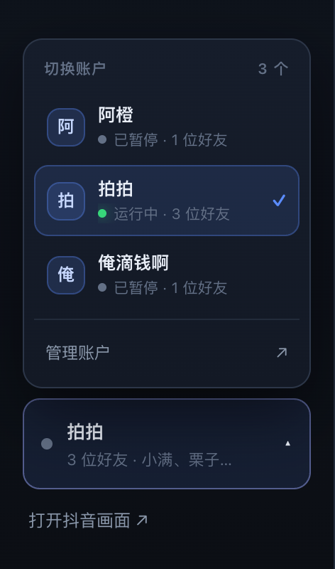
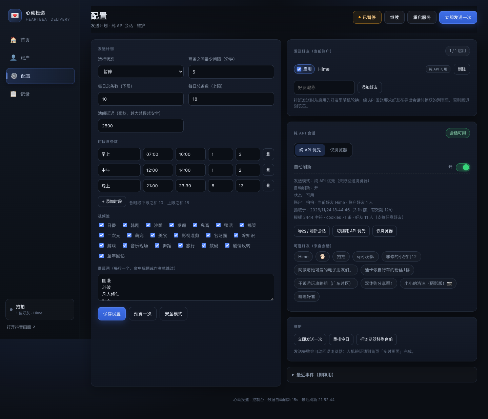

# 控制台

面板地址：`http://127.0.0.1:9400`（应用主窗口默认打开的就是它）。侧栏品牌名和页面底部显示当前版本号，
与安装包 `package.json` 的版本一致。

顶部页头在页面顶部是内容宽度内的圆角玻璃卡片；向下滚动 0-140px 时吸顶并向主内容区左右边缘
连续展开，最终变成通栏，向上滚回时反向收拢。

## 白天 / 黑夜模式

侧栏底部有主题切换按钮（当前模式：🌙 黑夜 / ☀️ 白天），点击即时切换并记住选择；
首次打开跟随系统外观。


## 首页

今日进度、纯 API 会话、浏览器状态三块卡片；发送成功率/今日失败/最常分类/累计发送；
今天的时刻表、分类分布；快速发送（互关好友下拉多选 → 只试选片 / 发送）；最近发送与最近事件；
可展开「实时画面」扫码或点验证码。

### 快速发送互关好友

首页快速发送不再直接铺开会话捕获的好友/群聊，而是一个互关好友下拉多选：

- 打开时读取上次同步的互关缓存；首次使用或点「刷新互关」会重新读取（10-30 秒，会拉起一次浏览器）；
- 支持按昵称搜索、全选当前结果、清空、多选摘要和「已选 N 位」计数；
- 发送时按好友 userid 建会话，不要求对方先出现在导出会话的最近好友里；
- 互关列表按账户缓存，显示更新时间；超过 6 小时标记「已过期」，可手动刷新。


## 账户

账户页按「当前账户 + 添加账户」两栏组织：当前账户展示昵称、好友、端口、时段、累计发送，
重命名和技术信息收在折叠区；添加账户默认只有一个「扫码添加账户」主按钮，手动创建账户/端口/首好友
收在「高级选项：手动创建」里。下方是全部账户列表，所有启用的账户由各自调度子进程**同时按自己的排班发送**；
「切到面板」只影响查看的数据。浏览器登录态和纯 API 会话都按账户独立。

### 快速切换账户

侧栏左下角的账户卡片就是快速切换入口：点击展开账户浮层，列出全部账户的昵称、运行/暂停状态
和好友数，当前账户带 ✓。点击其他账户立即切换，不需要跳到账户页；切换只改变面板查看的数据，
其他账户继续按各自排班发送。键盘可用 ↑/↓/Home/End 选择、Enter 切换，Esc 或点击浮层外部关闭。



### 互关好友

账户页底部的「互关好友」是可折叠区块：展开后点「获取互关好友」会通过已登录浏览器读取关注列表，
按 `follow_status=2 / relation_label=好友` 筛出互相关注，显示昵称、关注/粉丝/互关数量。
可勾选或「全部添加」为发送好友；导入的好友带数字 userid，纯 API 发送时可直接建会话。
读取较慢（自动拉起浏览器，10-30 秒），单次最多扫描 30 页。

接口说明：网页端没有独立的「互关列表」接口，只能读取
`/aweme/v1/web/user/following/list/` 后在客户端筛选；翻页游标使用响应的 `min_time`
（不是 `max_time`）。Desktop IM 的 `/aweme/v1/web/familiar/list/` 能直接返回好友名册，
但需要桌面端 IM 签名票据，不能直接复用网页登录态。

添加账户有两种方式：

- **扫码添加账户**：账户名可留空；点击后自动创建账户、打开浏览器窗口，手机扫码登录后自动识别抖音昵称；
- 仅创建（不扫码）：手动填账户名/端口/第一个好友，之后再打开实时画面登录。

新账户默认暂停；登录成功后还会是暂停状态，添加好友后点「继续」启用。账户页也可以手动点「识别抖音昵称」。


添加账户（终端）：

```bash
node src/index.js account add D --port 9335 --friend 好友昵称
node src/index.js account switch D
```

## 配置

- 发送计划：运行状态、间隔、每日总条数、视频最多几天前、时段与条数、视频池、屏蔽词；支持预览、保存、安全模式。
  每个视频池有多个同类搜索词，每次发送随机选一个；默认只发最近 7 天发布的视频，
  最近 30 天成功发过的视频优先跳过。
- 发送好友：当前账户的好友列表，可添加/启用/删除；排班时优先选当天成功发送次数最少的好友，
  让每位好友先各收到一条，再进入下一轮。好友会标注「纯 API 可用 / 未捕获」，
  未捕获的需要重新导出会话才能纯 API 发送。
- 纯 API 会话：发送模式（纯 API 优先 / 仅浏览器）、自动刷新开关、会话状态、
  导出/刷新会话、好友列表。
- 维护：立即发送一次、重排今日、把浏览器移到台前；最近事件。



## 记录

搜索、分类/结果筛选、成功失败统计、分页表格（含好友与截图）、CSV 导出、事件日志。


