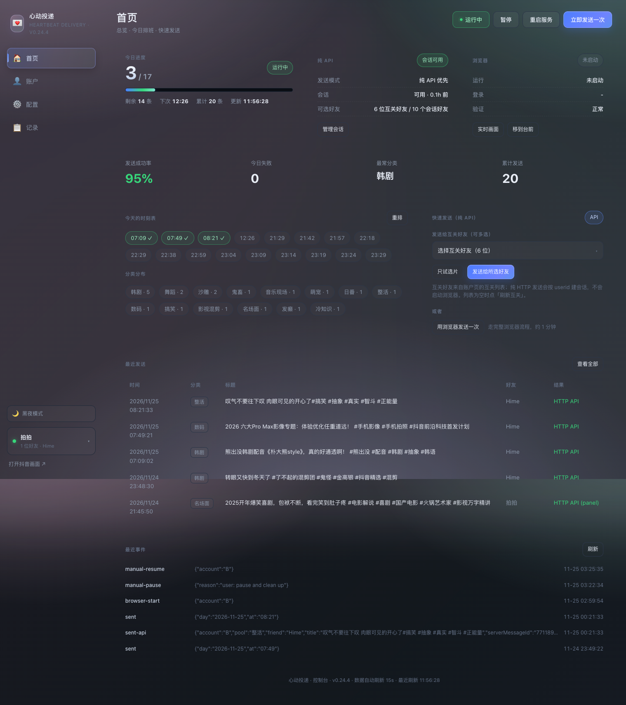
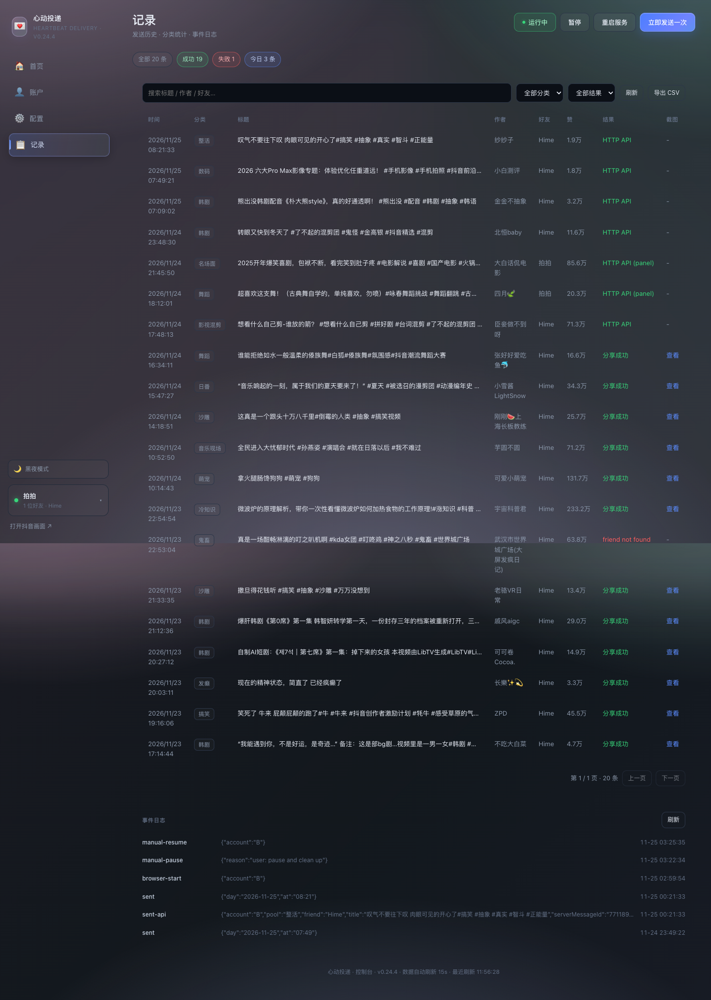

# 控制台

面板地址：`http://127.0.0.1:9400`（应用主窗口默认打开的就是它）。

## 首页

今日进度、纯 API 会话、浏览器状态三块卡片；发送成功率/今日失败/最常分类/累计发送；
今天的时刻表、分类分布；快速发送（直接勾选会话捕获的所有好友，可多选/全选 → 只试选片 / 发送）；最近发送与最近事件；
可展开「实时画面」扫码或点验证码。



## 账户

当前账户详情（昵称、好友、端口、时段、累计、浏览器 profile）；全部账户列表，可改名、暂停/继续、
切换面板。所有启用的账户由各自调度子进程**同时按自己的排班发送**；「切到面板」只影响查看的数据。
浏览器登录态和纯 API 会话都按账户独立。

添加账户：账户名称、端口（可自动）、第一个好友。新账户默认暂停；切到该账户后打开「实时画面」会自动启动浏览器，扫码登录后点「继续」启用。


添加账户（终端）：

```bash
node src/index.js account add D --port 9335 --friend 好友昵称
node src/index.js account switch D
```

## 配置

- 发送计划：运行状态、间隔、每日总条数、时段与条数、视频池、屏蔽词；支持预览、保存、安全模式。
- 发送好友：当前账户的好友列表，可添加/启用/删除；排班时从启用的好友里随机轮换。
  好友会标注「纯 API 可用 / 未捕获」，未捕获的需要重新导出会话才能纯 API 发送。
- 纯 API 会话：发送模式（纯 API 优先 / 仅浏览器）、自动刷新开关、会话状态、
  导出/刷新会话、好友列表。
- 维护：立即发送一次、重排今日、把浏览器移到台前；最近事件。


## 记录

搜索、分类/结果筛选、成功失败统计、分页表格（含好友与截图）、CSV 导出、事件日志。


